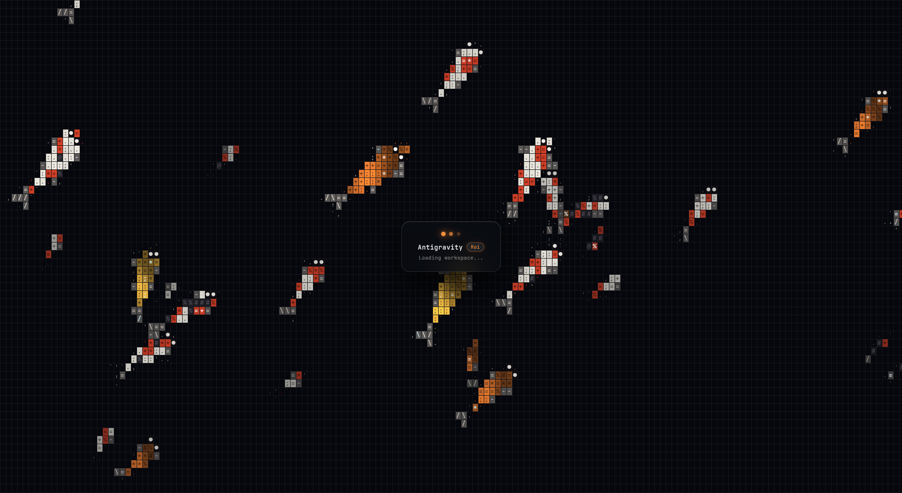
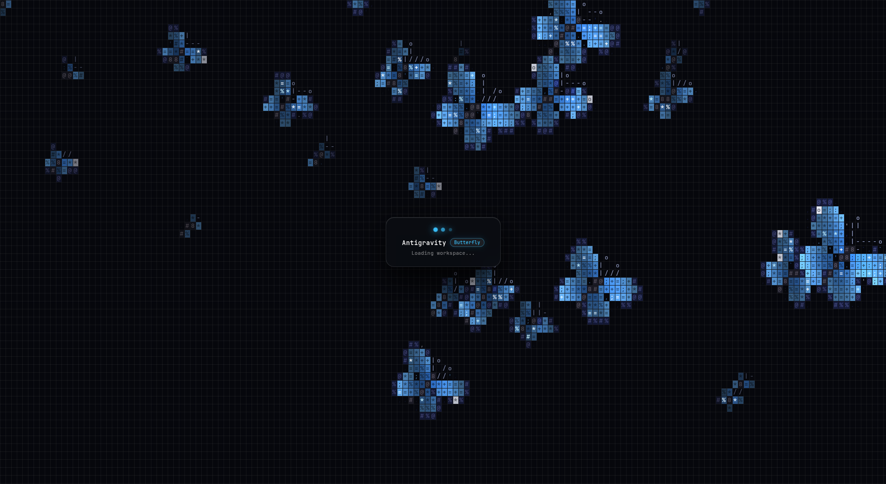
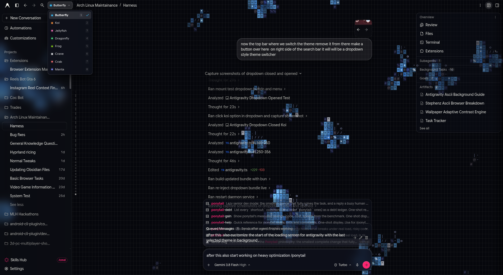
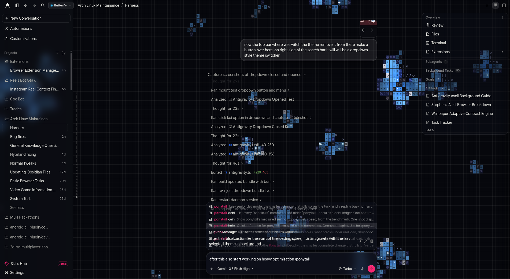
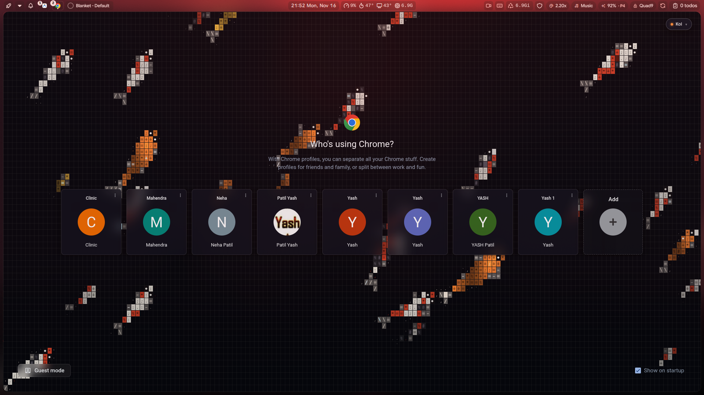
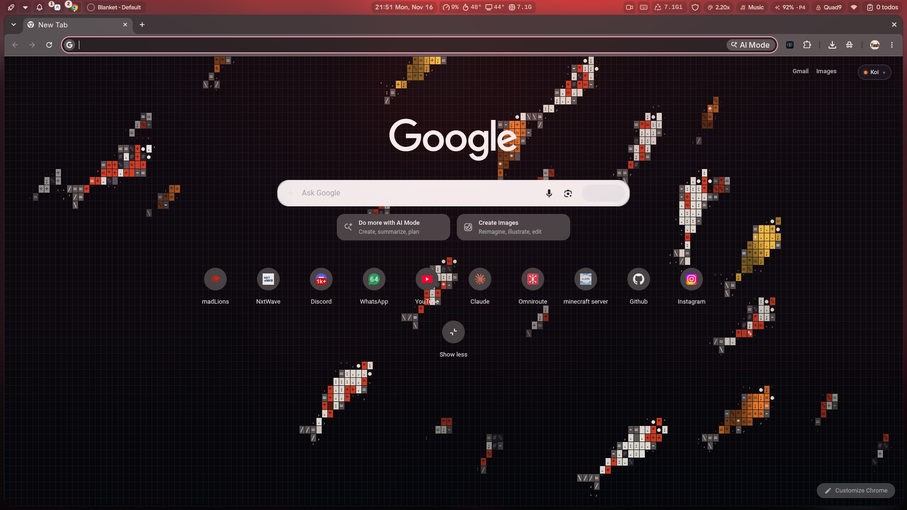

# Antigravity ASCII Animals · Living Background & Theme Suite

> Living procedural ASCII wildlife, top-bar species switcher, and persistent startup loading screen for **Google Antigravity Desktop** across **macOS, Windows, and Linux**.



---

## 🌟 Credits & Attribution

> [!IMPORTANT]
> **Core Simulation & Assets Credit:**  
> All core procedural ASCII simulation algorithms, creature models, mathematical kinematics, and rasterization math were created by **Stephen** ([DesignerStephen1/ascii-animals](https://github.com/DesignerStephen1/ascii-animals)).  
> We took Stephen's mesmerizing ASCII simulation and packaged it into a native, ultra-optimized desktop theme suite for Google Antigravity Desktop with seamless window integration, persistent theme synchronization, and cross-platform installation.

---

## ✨ Features

- **8 Animated ASCII Species**:
  - 🦋 **Butterfly** (`1`) — Blue morphos on migration: flutter, zigzag, and glide with wings flat.
  - 🐟 **Koi** (`2`) — Calico koi with lazy S-curves, kohaku, and responsive tap-to-feed interaction.
  - 🪼 **Jellyfish** (`3`) — Bioluminescent magenta pulse with marine snow and frilly twisting oral arms.
  - 🪲 **Dragonfly** (`4`) — Emerald hawkers: hover, dart, and cruise with veined wings.
  - 🐸 **Frog** (`5`) — Spotted leopard frogs that breathe, blink, and leap across the dark grid.
  - 🦩 **Crane** (`6`) — Red-crowned cranes in coordinated flight with splayed wingtips.
  - 🦀 **Crab** (`7`) — Scuttle sideways in bursts with pinching claws and sand trails.
  - 🌊 **Manta Ray** (`8`) — Oceanic giant manta with smooth undulating pectoral wing-waves and trailing whip tail.

- **Native Top-Bar Dropdown Switcher**:
  - Discreetly mounted directly to the right of the Search icon (`🔍`) in Antigravity's top navigation bar.
  - Shows active species indicator dot, label, and chevron: `[● Koi ▾]`.
  - Frosted glass dropdown menu displaying all 8 species, color-coded glowing dots, hotkeys, and active checkmarks.
  - Auto-closes on selection, outside click, or <kbd>Escape</kbd>.

- **Instant Keyboard Shortcuts**:
  - Press number keys **`1`** through **`8`** anywhere to switch species instantly.

- **Custom Startup Loading Screen**:
  - Electron loading overlay renders the full-screen ASCII simulation immediately on boot.
  - Automatically loads your **last selected animal theme** persisted to disk (`ascii_animal_theme.json`).
  - Sleek frosted glass center card with pulsing dots matching the species color accent, "Antigravity" branding, and theme pill badge.
  - Dissolves seamlessly into the workspace once React mounts.

- **Heavy Performance Optimizations**:
  - **Auto-Sleep on Window Hide / Blur**: Pauses the simulation loop when Antigravity is hidden, minimized, or in another workspace — **0% CPU and 0% GPU overhead** in the background.
  - **Single-Pass Bucketed Trail Rendering**: Replaced 6 nested grid loops (90,000 operations/frame) with a single pass over energy cells.
  - **Canvas FillStyle & Context Caching**: Skips redundant Skia string allocations and C++ state updates for identical cell colors.
  - **95% GPU Blur Reduction**: Pruned 78 nested backdrop-filters down to 5 dedicated layers, eliminating workspace lag.
  - **Capped 36 FPS Simulation & DPR=1**: Silky smooth retro ASCII feel with minimal power consumption.

---

## 📸 Screenshots

| **Startup Loading Screen (Koi)** | **Startup Loading Screen (Butterflies)** |
| :---: | :---: |
|  |  |

| **Dropdown Switcher (Open)** | **Dropdown Switcher (Closed)** |
| :---: | :---: |
|  |  |

| **Google Chrome Profile Picker** | **Google Chrome New Tab Page** |
| :---: | :---: |
|  |  |

---

## 🌐 Google Chrome Integration

The ASCII animal theme suite supports **Google Chrome, Brave, Edge, and Arc**:

### ⚡ Option 1: Chrome Extension (Recommended · 1-Click Setup)

Share and install effortlessly on any machine without touching system files or terminal commands:

1. Download **`antigravity-ascii-animals-chrome.zip`** (or use the [`chrome-extension/`](./chrome-extension/) folder).
2. Open `chrome://extensions` in your browser.
3. Enable **Developer mode** in the top-right corner.
4. Click **Load unpacked** (top-left) and select the `chrome-extension/` folder.
5. Press <kbd>Ctrl + T</kbd> (or <kbd>Cmd + T</kbd>) to open a New Tab:
   - Full-screen Obsidian Black (`#07080c`) procedural ASCII animal simulation.
   - Minimalist search bar with direct URL support & Google search.
   - Quick glass links to YouTube, GitHub, Gmail, Reddit, X/Twitter, Claude.
   - Top-right dropdown switcher + hotkeys `1`–`8` + `H` to toggle UI.
   - Toolbar popup to switch species anytime or toggle dark mode on `google.com`.

### 🛠️ Option 2: Direct Binary PAK Patch (Profile Picker + WebUI)

For local desktop power users who want `chrome://profile-picker/` and internal WebUI pages themed:

```bash
# 1. Build the Chrome bundle
bun run build:chrome

# 2. Patch resources.pak in userspace
python3 patch_chrome_pak.py

# 3. Launch Chrome with the patched overlay
google-chrome-stable --profile-directory="Default"
# or for Profile Picker:
google-chrome-stable --profile-picker
```

---

## 🚀 Quick Installation (Universal Cross-Platform)

The installer works out-of-the-box on **macOS**, **Windows**, and **Linux**. It automatically detects your Antigravity installation, makes a safe backup of the original `app.asar`, and patches in the ASCII engine.

### Prerequisites
- Node.js (v18+) **OR** Python (3.8+)
- Google Antigravity Desktop installed

---

### Option A: Node.js (Recommended)

```bash
# 1. Clone the repository
git clone https://github.com/DesignerStephen1/ascii-animals.git antigravity-ascii-animals
cd antigravity-ascii-animals

# 2. Run the installer
node install.js
```

### Option B: Python

```bash
# Run the Python installer
python3 install.py
```

### Option C: Non-Destructive Live Mode (Zero Disk Modification)

If you are on a restricted machine or don't want to modify `app.asar`:
1. Launch Antigravity with remote debugging enabled:
   ```bash
   antigravity --remote-debugging-port=9222
   ```
2. Start the live injector daemon:
   ```bash
   node daemon.cjs
   ```

---

## 💻 Platform Details & Paths

The installer automatically searches these standard locations:

### 🍏 macOS
- `/Applications/Antigravity.app/Contents/Resources/app.asar`
- `~/Applications/Antigravity.app/Contents/Resources/app.asar`
- Config & Theme State: `~/Library/Application Support/Antigravity/ascii_animal_theme.json`

### 🪟 Windows
- `%LOCALAPPDATA%\Programs\Antigravity\resources\app.asar`
- `C:\Program Files\Antigravity\resources\app.asar`
- Config & Theme State: `%APPDATA%\Antigravity\ascii_animal_theme.json`

### 🐧 Linux
- `/opt/Antigravity/resources/app.asar`
- `/usr/lib/antigravity/resources/app.asar`
- `~/.local/share/antigravity/resources/app.asar`
- `~/.config/Antigravity-Profiles/app.asar`
- Config & Theme State: `~/.config/Antigravity/ascii_animal_theme.json`

> **Custom Path:** If your Antigravity is installed in a non-standard directory, pass `--path`:
> ```bash
> node install.js --path /custom/path/to/app.asar
> ```

---

## 🔄 How to Uninstall

To cleanly restore your original Antigravity installation from backup:

```bash
# Node.js
node install.js --uninstall

# Python
python3 install.py --uninstall
```

---

## 🛠️ Project Structure

```
antigravity-ascii-animals/
├── assets/                     # Screenshots and visual documentation
│   ├── preview_dropdown_closed.png
│   ├── preview_dropdown_opened.png
│   ├── preview_loading_butterflies.png
│   └── preview_loading_koi.png
├── dist/
│   └── antigravity_iife.js     # Compiled bundle (111 KB, zero external runtime deps)
├── src/
│   ├── animals/                # 8 creature simulations
│   │   ├── butterflies.ts
│   │   ├── crabs.ts
│   │   ├── cranes.ts
│   │   ├── dragonflies.ts
│   │   ├── frogs.ts
│   │   ├── jellyfish.ts
│   │   ├── koi.ts
│   │   └── manta.ts
│   ├── antigravity.ts          # Dropdown UI, hotkeys, translucency styles
│   ├── engine.ts               # Simulation loop, visibilitychange auto-sleep
│   ├── flock.ts                # Boids steering, spatial wrap, startle dynamics
│   ├── ink.ts                  # Shaders, palettes, and vector lighting
│   ├── math.ts                 # Fast trig and hash utilities
│   └── renderer.ts             # Cellular ASCII renderer, bucketed trails
├── daemon.cjs                  # Standalone background synchronization service
├── install.js                  # Cross-platform Node.js installer
├── install.py                  # Cross-platform Python installer
├── loadingOverlay_custom.js    # Customized startup loading overlay
├── package.json
└── LICENSE
```

---

## 📄 License

MIT License. Core ASCII animal simulation assets and algorithms are Copyright (c) 2026 Stephen ([DesignerStephen1](https://github.com/DesignerStephen1)).
